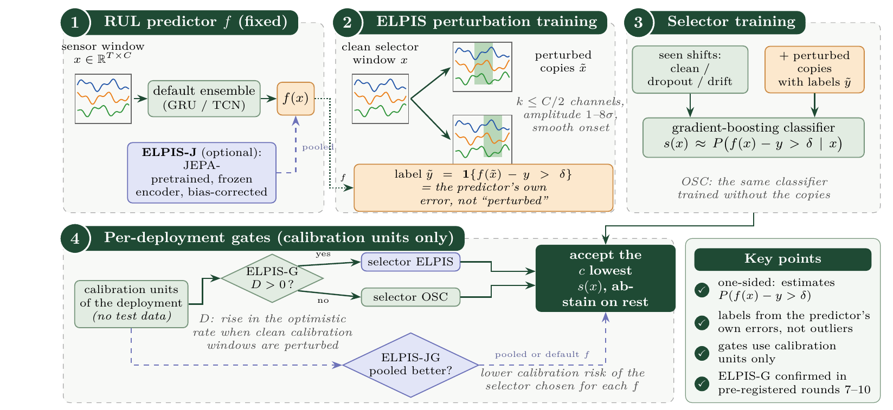

# ELPIS: Error-Labelled Perturbation Training for Selective RUL Prediction under Sensor Faults

ELPIS is the follow-up to the one-sided selector of the main paper (OSC, called `full` in the code). It keeps the RUL
predictor fixed and changes only how the **selector** is trained:
- random channel subsets of clean selector windows receive large smooth perturbations;
- each perturbed copy is labelled by whether the **same predictor** becomes optimistic on it, `1{f(x̃) − y > δ}`,
  not by whether it was perturbed;
- the gradient-boosting selector is trained on these copies together with the seen shifts (clean, dropout, drift).

ELPIS is the method of the paper. A pre-registered gated variant, **ELPIS-G**, decides per deployment whether to use
ELPIS: it perturbs the deployment's clean calibration windows and uses ELPIS only if the predictor's optimistic rate rises
(`D > 0`), otherwise OSC. ELPIS-G was the variant tested in confirmatory rounds 7–10. It avoids the harm of ELPIS on real
hard drives but gives up part of the gain on bearings, so the paper reports ELPIS and treats ELPIS-G as a variant.



*Pipeline. (1) A fixed ensemble predictor. (2) Error-labelled perturbation training. (3) A gradient-boosting classifier
estimates `P(f(x) − y > δ | x)`; OSC is the same classifier without the perturbed copies. (4) Abstention with a threshold
fixed on clean calibration units (the gated variant ELPIS-G additionally switches to OSC when `D ≤ 0`). Dashed (exploratory): ELPIS-J, a JEPA-pretrained predictor whose members can be pooled with the
default ones, and ELPIS-JG, which picks the default or the pooled predictor by calibration risk.
Source: [`figures/pipeline.pdf`](figures/pipeline.pdf), TikZ in [`figures/fig_pipeline_tikz.tex`](figures/fig_pipeline_tikz.tex).*

## Paper (ESANN format)

| File | Content |
|---|---|
| [`esann/ELPIS_ESANN_6p.pdf`](esann/ELPIS_ESANN_6p.pdf) | 6-page ESANN paper |
| [`esann/ELPIS_ESANN_supplementary.pdf`](esann/ELPIS_ESANN_supplementary.pdf) | supplementary material: the complete extended version (all sections, tables, figures and appendices) |
| [`esann/main.tex`](esann/main.tex) | LaTeX source of the 6-page paper (`esannV2.cls`, `refs_esann.bib`, `fig_pipeline_esann_tikz.tex`) |
| [`esann/supplementary.tex`](esann/supplementary.tex) | LaTeX source of the supplement (`refs.bib`, `figures/`) |

Both compile with `pdflatex` + `bibtex` (or `tectonic -X compile main.tex`). The paper is a draft: author names and
affiliations are placeholders.

## Names used in the code

| Paper | Code (selector / score name) | Introduced in |
|---|---|---|
| OSC (one-sided classifier, main paper) | `full` | main paper |
| ELPIS-R (round-1 variant) | `full_recon_rpt` | EXT10 |
| **ELPIS** (method of the paper) | `rpt_L` | EXT12 |
| ELPIS-CAL (calibration-risk switch) | `rpt_auto` | EXT22 |
| ELPIS-G (pre-registered gated variant, rounds 7–10) | `rpt_auto_d` | EXT38 |
| ELPIS-J (JEPA-pretrained predictor) | `ELPISJ_*` options of `scripts/ext50.py` (final: `ELPISJ_FREEZE=1 ELPISJ_BIASCAL=1`) | EXT50–EXT59 |
| ELPIS-JG (default vs pooled predictor) | `ELPISJ_HYBRID=1` + `scripts/ext64_summary.py` | EXT64–EXT65 |

In the protocols and findings, "ELPIS-J" names the whole family of JEPA-style predictors tried in `scripts/ext50.py`
(variants V1–V17, and V20 in EXT66); the ELPIS-J of the paper is variant V13 (`ELPISJ_FREEZE=1 ELPISJ_BIASCAL=1`).
V20 (`ELPISJ_SSL=sigreg`, EXT66) replaces the EMA teacher by end-to-end training with SIGReg (LeJEPA / LeWorldModel);
it was not adopted (see `extensions/results/ext66/FINDINGS.md`).

The perturbation generator is `perturb()` in `scripts/ext11_ablate.py` (ELPIS: `kfrac=0.5`, `amp=(1, 8)`, two copies); the selector features, seen shifts and
evaluation faults are in `scripts/ext10_rpt.py` and `src/selective_rul/faults.py`.

## Main results

Risk = optimistic-error rate (%) among accepted windows at 90% matched coverage, averaged over six unseen faults.
Ten confirmatory rounds were pre-registered with α-spending (α_j = 0.05/2^j, family-wise error < 0.05); see
[`../extensions/protocols/SEARCH_LOG.md`](../extensions/protocols/SEARCH_LOG.md).

| Round 8 (30 fresh seeds 162–191, seed-level) | C-MAPSS | N-CMAPSS | Bearings | Batteries | Hard drives |
|---|---|---|---|---|---|
| Risk, OSC | 8.78 | 8.14 | 24.39 | 3.31 | 15.56 |
| Risk, ELPIS | **8.14** | **7.86** | **22.96** | **2.27** | 15.98 |
| Seeds where ELPIS beats OSC (of 30) | 30 | 30 | 28 | 30 | 0 |
| Risk, ELPIS-G (tested variant) | 8.14 | 7.86 | 23.77 | 2.27 | 15.56 |
| Seeds where ELPIS-G beats OSC (of 30) | 30 | 30 | 27 | 30 | 0 (equal) |

The confirmatory test of round 8 was ELPIS-G vs OSC; the ELPIS rows are descriptive on the same seeds. ELPIS itself was
confirmed in rounds 2 and 3 (four benchmark families).

- Round 9: ELPIS-G removes 0.71–2.04 points of fault-induced excess risk on the windows a fault changes (C-MAPSS,
  N-CMAPSS, batteries; 30/30 seeds).
- Round 10 (JEPA-pretrained predictor ELPIS-J, seeds 222–251): ELPIS beats OSC in 30/30 seeds on C-MAPSS, bearings and
  batteries (−0.81, −1.37, −1.14 points; exploratory, same seeds); the confirmed variant ELPIS-G gives −0.81, −1.03, −1.14.
- ELPIS is significantly better than 16 external baselines on all four benchmark families (EXT14, 68 Holm-corrected tests).
- Negative result: on real hard-drive failures (Backblaze) ELPIS is worse than OSC (+0.41 points, 30/30 seeds in round 8),
  because selector data are plentiful there; ELPIS-G never switches on hard drives and equals OSC. Use ELPIS when
  selector data are scarce.
- Exploratory: ELPIS-JG lowers risk on C-MAPSS and batteries (−0.58, −0.54) and ties on bearings (−0.56 on 60 fresh
  seeds, 28/60 improved, p = 0.11).
- Exploratory (EXT66–EXT67): the EMA teacher of ELPIS-J partially collapses its embedding (effective rank 9–16); a
  SIGReg variant trained end-to-end (LeJEPA / LeWorldModel) lifts it to 20–31. A calibration gate between the two
  variants lowers ELPIS-G risk against ELPIS-J by 1.03 (C-MAPSS) and 1.20 (bearings) points and ties on batteries on
  30 seeds not used to design it, at 1.2–1.7 points more pessimistic error; on bearings the default predictor stays better.

## Reproducing

Data preparation and ensemble training use the main pipeline (see the top-level [`README.md`](../README.md) and
[`docs/`](../docs)). Hard-drive data: `scripts/prepare_hdd.py`; raw-signal bearing faults: `scripts/prepare_rawfaults.py`.

```bash
# 1. train default ensembles (C-MAPSS via scripts/run_matrix.py; other families:)
uv run python scripts/run_external.py --data-dir data/external/processed --out runs/conf162_ext \
    --config configs/external.json --datasets bearings battery ncmapss --seeds 162 163

# 2. evaluate OSC, ELPIS and ELPIS-G on those runs (one CSV row per run x scenario x score)
uv run python scripts/ext38.py --runs runs/conf162_ext --out out/ext40 --device cuda --shard 0/6

# 3. ELPIS-J / pooled predictor (exploratory)
ELPISJ_FREEZE=1 ELPISJ_BIASCAL=1 ELPISJ_HYBRID=1 \
uv run python scripts/ext50.py --runs runs/conf162_ext --out out/ext64_hybrid --device cuda --shard 0/6

# 4. summaries (each round has its own *_summary.py; inputs are the concatenated CSVs of step 2/3)
uv run python scripts/ext40_summary.py out/ext40/all_ext40.csv.gz out/ext40_summary
uv run python scripts/ext64_summary.py out/ext64_default.csv.gz out/ext64_hybrid.csv.gz out/ext64_summary 252 281
```

Every round has a protocol frozen before it was run (`extensions/protocols/EXT*_PROTOCOL.md`, written in Vietnamese) and
its outputs and findings in `extensions/results/ext*/` (`FINDINGS.md`, summary CSVs and the raw per-run results
`all_*.csv.gz`). The round list is in [`../extensions/README.md`](../extensions/README.md).
